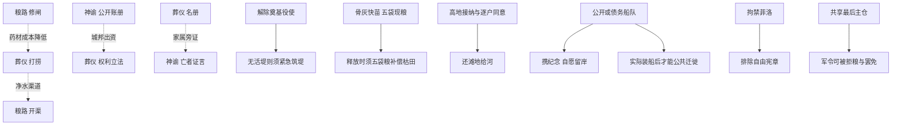

# 四章叙事状态图与因果账

内容版本2，campaign.id=the-unburied-city-four-chapters。旧12节点断点留在 checkpoints/greek-12nodes-88tests-baseline.zip；当前文件不覆盖归档。下图描述实际 next 与章节等待机制，不把三条主线排成固定先后。

每章每条线有3个顺序场景；一条线走完后 stage 指下章首，status仍为active但不可提前选择。三条均离章后才应用下一章arrivalEffects。失败标记永久保留，不通过后章合作清空。第四章提前失败写 final=lost（神谕为constitution=silence）并 next=failed。

## 36场逐节点索引

| 章 | 主线 / stageId | 场景 | 地点 | 常规下一场 / 章失败出口 |
| --- | --- | --- | --- | --- |
| 1 | burial / `burial_names` | 一张没有名字的告示 | agora/notice | `burial_pyre` / `burial_law` |
| 1 | burial / `burial_pyre` | 没有足够柴薪的夜晚 | necropolis/pyre | `burial_water` / `burial_law` |
| 1 | burial / `burial_water` | 被水带走的遗物 | cistern/sluice | `burial_law` |
| 2 | burial / `burial_law` | 谁有权成为死者 | tribunal/seal | `burial_citizens` / `burial_foundation` |
| 2 | burial / `burial_citizens` | 活人的名册 | agora/notice | `burial_reparations` / `burial_foundation` |
| 2 | burial / `burial_reparations` | 多罗斯的旧命令 | tribunal/seal | `burial_foundation` |
| 3 | burial / `burial_foundation` | 河底的第一位守门人 | cistern/sluice | `burial_nightwatch` / `burial_memorial` |
| 3 | burial / `burial_nightwatch` | 愿意留下的夜哨 | necropolis/pyre | `burial_lowquarter` / `burial_memorial` |
| 3 | burial / `burial_lowquarter` | 低地的家不是代价一词 | agora/notice | `burial_memorial` |
| 4 | burial / `burial_memorial` | 最后一块可搬走的碑 | necropolis/pyre | `burial_guardian` / `failed` |
| 4 | burial / `burial_guardian` | 她可以拒绝的守桥约 | cistern/sluice | `burial_final_rites` / `failed` |
| 4 | burial / `burial_final_rites` | 城门这一侧与河的另一侧 | necropolis/pyre | `complete` / `failed` |
| 1 | harvest / `harvest_ledger` | 双层粮簿 | granary/ledger | `harvest_sluice` / `harvest_seedtime` |
| 1 | harvest / `harvest_sluice` | 不能只向天空求雨 | cistern/sluice | `harvest_rations` / `harvest_seedtime` |
| 1 | harvest / `harvest_rations` | 种子与面包 | agora/notice | `harvest_seedtime` |
| 2 | harvest / `harvest_seedtime` | 把第一粒留给谁 | granary/ledger | `harvest_port` / `harvest_salt_seed` |
| 2 | harvest / `harvest_port` | 救济船的系缆柱 | agora/notice | `harvest_debt` / `harvest_salt_seed` |
| 2 | harvest / `harvest_debt` | 欠债的人不是一袋种子 | tribunal/seal | `harvest_salt_seed` |
| 3 | harvest / `harvest_salt_seed` | 被德墨忒耳留下的空穗 | granary/ledger | `harvest_floodplan` / `harvest_last_stores` |
| 3 | harvest / `harvest_floodplan` | 一座堤或三条退路 | cistern/sluice | `harvest_fleet` / `harvest_last_stores` |
| 3 | harvest / `harvest_fleet` | 船票上能写几个名字 | agora/notice | `harvest_last_stores` |
| 4 | harvest / `harvest_last_stores` | 储备不够所有人的所有要求 | granary/ledger | `harvest_last_tide` / `failed` |
| 4 | harvest / `harvest_last_tide` | 最大潮水只来一次 | cistern/sluice | `harvest_final_contract` / `failed` |
| 4 | harvest / `harvest_final_contract` | 粮食最后由谁保管 | agora/notice | `complete` / `failed` |
| 1 | oracle / `oracle_verses` | 两份相反的神谕 | sanctuary/tripod | `oracle_accounts` / `oracle_public` |
| 1 | oracle / `oracle_accounts` | 替神签名的人 | tribunal/seal | `oracle_witness` / `oracle_public` |
| 1 | oracle / `oracle_witness` | 沉默者的证词 | necropolis/pyre | `oracle_public` |
| 2 | oracle / `oracle_public` | 不替诸神说最后一句话 | sanctuary/tripod | `oracle_copies` / `oracle_stone_voice` |
| 2 | oracle / `oracle_copies` | 可以被查到的空白 | sanctuary/tripod | `oracle_teacher` / `oracle_stone_voice` |
| 2 | oracle / `oracle_teacher` | 老师坐到证人席 | tribunal/seal | `oracle_stone_voice` |
| 3 | oracle / `oracle_stone_voice` | 阿波罗留下的半句话 | sanctuary/tripod | `oracle_mandate` / `oracle_philo_choice` |
| 3 | oracle / `oracle_mandate` | 谁可以说我们 | agora/notice | `oracle_witness_safety` / `oracle_philo_choice` |
| 3 | oracle / `oracle_witness_safety` | 活着的人也需要渡口 | tribunal/seal | `oracle_philo_choice` |
| 4 | oracle / `oracle_philo_choice` | 菲洛想说哪一句 | sanctuary/tripod | `oracle_foreign_terms` / `failed` |
| 4 | oracle / `oracle_foreign_terms` | 停战书上的小字 | tribunal/seal | `oracle_final_mandate` / `failed` |
| 4 | oracle / `oracle_final_mandate` | 最后一次说我们 | agora/notice | `complete` |

## 可执行的横向边

这些边有真实 requires、cost、effects 或最终分支，不是只在旁白提醒。前三章同线基础推进不要求先完成另一线；横向选项只改变成本或开放不同办法。第四章迁徙、还河、守桥等有真实准备前提，但始终有其他无前置出口，不因无钱或无船永久卡住。

## 章目标失败的具体承接

| 损失 | 下一章承接 | 永远不被谎称恢复的东西 |
| --- | --- | --- |
| 没登记或删名字 | 户籍与赔偿面对无资格家属，末章碑必须保留未知 | 未知姓名、错过的第一场告别 |
| 砌住遗物或冲向低地 | 低地修复、赔偿、高地安置由责任人付账 | 已毁遗物、损坏房屋与旧命令 |
| 吃掉旧种源 / 本季弃播 | 公开海岛补给可带新种，按来源重新筛选 | 旧本地种源与失去的一季 |
| 烧原板 / 禁止听证 | 只能重建可交叉核的记录，来源与空白分开 | 毁掉的笔迹与无法核证的神谕词 |
| 续役 / 骨灰快苗 | 之后可以释放，但需真实补偿枯苗与重建活堤 | 已役使的时间与已吃下的冷麦 |
| 船路谈判或见证保护失败 | 终章无法靠临时命名获得船位与安全 | 错过船期、已失踪证人 |
| 末章共同仓失败 | 私有种源仍可在，但无统一生产/采购承诺 | 公共议价与风险共同承担能力 |

## 最终有限状态与覆盖边界

最终授权 oracle_constitution 只来自终章实玩选择：assembly、temple、council、regency、diaspora、silence。神谕终章提前失败也明确写silence，故每个正常可finish状态都有一个此枚举值。不同授权下再检查具体遗产，不将三条善恶轴做笛卡尔积。

各授权分支有若干具体条件q1...qn，最后一个为补集。第i个 requires 为 mode AND qi AND NOT(any(q1...q(i-1)))，最后为 mode AND NOT(any(q1...qn))。这使互斥与覆盖由逻辑结构保证；引擎仍严格检查exactly1，QA以24真实见证、合法末选组合与失败续线检验实现。未穷举所有152个选择的排列，也不把样本数称作全空间穷举。

## 神话与机制边界

真实原典只支持葬仪改变亡者处境、德墨忒耳饥荒与祭约不可轻言、阿波罗神谕圣域背景。本作役魂护岸、骨灰田、守桥退出权与泉影为原创的游戏内实在因果，不能反过来当作历史事实。对话中的伦理和制度不替代神圣作用；神圣作用也不替代人对强制与损害的责任。
