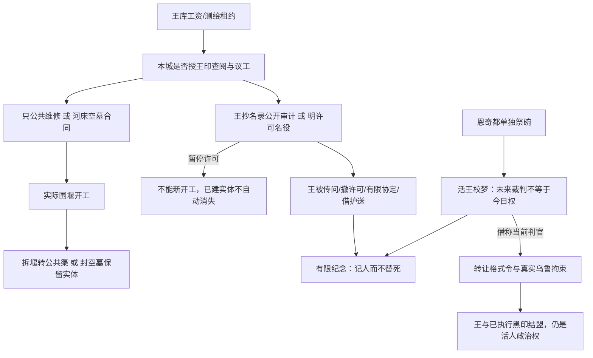

# 吉尔伽美什核心 NPC 设计与因果图

状态：3.1实施对照稿。数据与十二项专项已落盘并通过；最终文学关闭状态另见独立审查，不以本设计代审查。唯一工作根为本目录所属 mesopotamia-v3-1-gilgamesh；v3 与旧 G 盘候选只读。保留27节点、9路线、24主终局与原124 choice IDs/成本，新增21选择和真实王权状态。campaign.id 改为 wet-seal-iii-gilgamesh-3-1，标题标明3.1，旧存档不冒充同一战役。

## 原典与原创框架

本人直接浏览核对了牛津 ETCSL：
- [The death of Gilgamesh](https://etcsl.orinst.ox.ac.uk/section1/tr1813.htm)：Me-Turan F 将未来幽魂的裁判身份置于死亡之后，随后有梦醒；H 有征发、改道与河床石墓。页面明示缺行与部分段落顺序不定。这里只借“王亦会死、能调动工程却不能调停死亡”的冲突。
- [Gilgamesh and Aga](https://etcsl.orinst.ox.ac.uk/section1/tr1811.htm)：井工议题、长老与壮年回应有差异，王不采长老意见。它作为此王和歌者会引用的旧诗记忆，不重演阿伽围城，也不把壮年响应当现代全体授权。
- [Gilgamesh, Enkidu and the nether world](https://etcsl.orinst.ox.ac.uk/section1/tr1814.htm)：核对恩奇都受拘、乌图开孔带回回声/气息的疑译与腐坏对话；不据此给永久肉身复活。当前恩奇都作为已经失去的友人，死亡原因不从未核读的标准巴比伦史诗填补。

本作的吉尔伽美什是**仍活着、做过有限死梦的乌鲁克王**，不是已在任冥界判官。梦不能保证应验，也不给今日越过埃列什基伽勒的执法权。乌图只能作为光下见证和所读文本中的援助形象；伊南娜的恩顾歌辞不授予纳鲁渡征调权；冥界王权独立于人间王。三部作品不是同一历史年表。

纳鲁渡不是乌鲁克的已知属城。本作原创前提是艾迪勒邀请王的测水队评估一段本城旧河床；王以自己的粮与技师提出合同，逐步要求调查、名录与开工许可。他能支配自己带来的人和物，不能不经当地授权征本地役。河床隐墓在纳鲁渡的提议是有标记的原创移置，非宣称发现历史吉尔伽美什墓。墓室先为空，不殉葬妻、子、同伴或居民。

恩奇都是唯一、不可替换的失落。王可以想听见那个声音，但乌鲁、伊利、苏恩父亲都不能代替他；普通人的哀悼不以王悲伤更宏大为由退场。

## 核心人物与边界

公开身份为“乌鲁克来王”。他带真实粮、测水人与工程知识，有慷慨和行动力；恐惧的是自己的名字终有一日无人回答。他想把被洪水藏起的石室与供水工程一起规划，再把参与者列入纪名册。纪念可合法、有限、受监督；把帮助升级为不问同意的征役与名序特权，则是真正阴暗分支。

majorNpcs 只放 id=gilgamesh，绝不进入 companions/party、不可认领、不自动战斗。公开外貌为壮年、有重量的王者，使用独立原创肖像，不戴现任冥界判官冠、不发神光。开场即公开来访，省略 knownFromFlag。

canonical 数据：
- effects.npcRelationships:{gilgamesh:delta}
- requires.npcRelationships:{gilgamesh:min} / npcRelationshipsMax:{gilgamesh:max}
- stances/milestones:[{id,requires,title,text}] 可并存，用于公开许可、约束与历史，不是互斥心理槽。
- 没有关系分能替工人、船主、证人或亡者签名。NPC关系只开放明确自愿的谈判帮助，不自动给统治授权。

## 九个必经关键节点与旧选择回应

下列是每章每线至少一处核心冲突；新增选择之外，旧选择也直接处理他的行动，不能沿原124边把王整段绕掉。

| 章/线与节点 | 王主动做什么 | 旧选择写入的实际回应 | 新选择与后续操作 |
| --- | --- | --- | --- |
| ch1-canal-1 | 拿自己王库的钱付真工资，换一次有限测绘机会；工程队当场到岸 | pay 确立 gilg_local_purse_independent；iou 拒绝王库代付；divert 留下他所见的家属款侵吞，不把王自动写成下令者 | royal-wages：王直接付十二工资、不扣队伍银，粮+4，只得测绘租约；不准挖墓，也不向工人追还已付工资 |
| ch1-archive-3 | 递来要抄取城籍与征调依据的王印书 | limited 给 gilg_writ_bounded，只许当地受理不授王征役；unheard 留 gilg_warrant_denied；emergency 只授艾迪勒，不冒称授外王 | royal-warrant 授明示王队查阅/议工权限；royal-limited 限测绘和匿名汇总，取得可执行监督条 |
| ch1-descent-3 | 站在活绳另一侧，请求把恩奇都的名字放入自己的祭碗 | truth 让父债与外来工各有名字，也迫王听见别人；protect-father 展示“有名者可获遮蔽”的诱惑但不自动给王神权 | two-bowls：恩奇都与苏恩父亲分碗，王承认无人能替换友人，gilg_enkidu_named；父债依然读出 |
| ch2-canal-2 | 摊开空墓室、围堰与本城渠的重叠测绘，承诺六袋真冬粮 | confess 形成 gilg_workers_independent，本地工人不能被“为大家”变成王墓役；cover 留相反的征役借口史 | royal-tomb 才签河床工程合同；royal-repair 只用王队做公共维修，拒墓不等于拒一切帮助 |
| ch2-archive-3 | 带来把工班和住户写成“将来跟随王”的名录，必须当面解释 | commons 拒名役，gilg_name_levy_refused；house 只允许当地城库集权，不默给外王；none 留未获当地权源 | audit-royal 把王的已授权抄本公开审计、暂停许可；royal-levy 明确给名役/纪名特权，促后章索取 |
| ch2-descent-2 | 带自己的死梦来校反印，问未来幽魂裁判身份能否现在生效 | read/witness 明确 gilg_future_not_present：今日活王不等于梦中未来裁判；transfer 不被冒写成神命 | royal-dream 让他亲自接受边界、提供一份可复核抄本；royal-claim 则借梦造今日转让格式令，真实拘束乌鲁但无神授权 |
| ch3-canal-1 | 已获许可时真的围堰施工；没获许可时只能在岸外带队等候 | workers 维护本地工班独立调度；repair 不自动完成王墓；record 不把王未获许工程补成已动工 | reassign-royal 暂停墓工拆堰补渠；negotiate-royal 用受限公共王队补闸；seal-royal-tomb 完成空墓并保留该工段经营限制与跨堰两步难行，不能抹低街/盐地 |
| ch3-archive-1 | 王印书与本城问责一同受问，王必须来答自己许过什么 | testify 保留卡拉特本人声音，不让王代答；submit 不自动抹去外王越权；已有保护仍保护证人 | summon-king 公开收回王的征调/抄名许可；bind-royal-warrant 把承诺锁为有限纪念；borrow-royal-seal 超用工程牌冒称王护人令，真挡报复且王追索实牌与公开更正 |
| ch3-descent-3 | 王在阈外等，面对今日活名、不可替代的恩奇都和梦的边界 | release 真实否定他今日冥界裁判权；close 让他随未解债返岸；旧crown不自动让他成为共同统治者 | royal-finite-memorial 在反印/净水与本人承诺都成立时接受有限纪念；crown-royal 才以已执行黑印与活王结盟，构成有名/无名索取秩序而非封神 |

其余节点用真实 sceneVariants 展示工程队、送路条、名单与王的回应；不让被拒的王突然有军队接管，也不让没有发生的工程出现泥堆。正文的每条权力断言必须有对应 flag。

## 新增21选择与六类以上可执行变化

| 类别 | 生产者 | 消费者与真实后果 |
| --- | --- | --- |
| 王库工资与有限勘察 | ch1-canal-1/royal-wages → wages_paid, paid_hands, gilg_survey_lease, gilg_credit_accepted；粮+4 | 原工班低成本维修确实可用；新royal-engineers可谈公共施工。帮助并不消假签或城库欠责 |
| 王印权限 | ch1-archive-3/royal-warrant → gilg_royal_warrant, gilg_archive_access | 开王墓合同、公开审计王抄本、借工程牌威势、当面对王收回许可；拒绝则这些选项不可用 |
| 恩奇都单独纪名 | ch1-descent-3/two-bowls → gilg_enkidu_named | 让王有具体信任缘由，开放其亲自校梦及终章有限纪念；不复活任何人 |
| 河床工程合同与开工 | ch2-canal-2/royal-tomb；ch2-canal-3/royal-cofferdam → gilg_tomb_contract, gilg_tomb_works, gilg_tomb_works_active | 地图局部围堰改变行路；终章可拆堰改公渠或封空墓保留经营条款与难行地，不能只用后记假装施工 |
| 名役公开审计 | ch2-archive-3/audit-royal → gilg_levy_audited, gilg_survey_suspended | 暂停继续开工/新增名役；已付工资与已完成实体不倒退。拆围堰须另有实际动作 |
| 活王/未来幽魂边界 | ch2-descent-2/read/witness/royal-dream → gilg_future_not_present | 正当撤约不靠王的未来头衔；有限纪念有边界；royal-claim 相反给 gilg_judicial_usurpation 并扣乌鲁 |
| 终章拆堰或封墓 | reassign-royal → gilg_tomb_stopped, gilg_river_unblocked，清 active；seal-royal-tomb → gilg_tomb_sealed, gilg_river_reserved | 实体两步地形的保留/清运与公共维修发生可观测变化；封墓不能再无条件选有限纪念“没有隐墓”版本 |
| 临时护送与撤销许可 | borrow-royal-seal / summon-king | 真阻断一次找证人报复，或取消王的持续征调/查阅权限；四同伴的原保护/认责不被取代 |
| 有限纪念与黑印联盟 | royal-finite-memorial / crown-royal | 接受会死的活王与滥用未来名位的活王有相反去向；同一旧主终局将因不同真实王权状态呈现不同后果 |

支援写在一次性节点并受 notFlags 支援flag保护，不能循环提款。所有新增第三节点选择写本章 settled 且 completeRoute XOR failRoutes；所有旧免费失败出口保留。没有新增章门硬依赖，不因拒王锁任何主线。

## 图与权限撤销顺序

原24主终局的互斥条件保留，不靠扩大主终局数量凑更新。每项主文增加**该政体/债制如何处置这位活王**的独特动作；主文按各终局已成立的政体与债制展开；另以王的实际合同/拒绝/有限纪念/黑印联盟状态叠加条件后记。不会把同一“王回乌鲁克”段落无差别附24次。

## 四同伴不被压扁的验收

卡拉特仍须解释自己假签获益，王付薪不买无罪；公共王队也不能替工班同意墓役。妮萨雅能审王的抄本且拒以王名揭匿名者；原件/分存仍有独立意义。贝鲁的船不因王到访变公产，新增王队不能绕过未归船索赔。苏恩父亲与外来工有各自祭名，恩奇都不占走他们的哀诉；苏恩仍只能本人签有限服务。

## 审查与真实测试计划

1. 检查9关键节点中旧选择也产生可消费王权后果；至少6新增状态确实改变可用操作/资源/盟友/地图/结算。
2. 原124选择id仍在、旧基础资源路径和所有24主结局回归继续通过。
3. 新测试从正式初始state真实走支持但限定、反对并公开审计、利用护送、放任墓工、有限纪念、黑印联盟；不注入flags/资源/胜利。
4. NPC永不进入party；支援不重复；关系上下限拒绝越界；世俗王无法顶替埃列什基伽勒或永久复活恩奇都。
5. 对有墓/无墓、已停/仍施工、已撤/仍许可混合状态检查场景与末后，不让静态正文虚报。
6. 新结果只写到本新根证据；旧v3的通过记录不代替3.1验收。

## 实施后的精确约束

精确21项新边、关系delta、flag清除与消费者见 [状态图](NARRATIVE-STATE-GRAPH.md) 新表；24项王方动作见 [矩阵](ENDING-MATRIX.md)。正式数据为145选择、24主归宿、50条件后记；原124边的费用/资源/同伴/阵营数值由嵌入基线断言保留。

- royal-warrant仅登记王队许可，不给provisional_jurisdiction，留下 gilg_local_case_deferred 待中章追问。royal-limited若承接受理则必须 gate_order。
- audit-royal暂停墓工/名役新申请，royal-tomb和royal-cofferdam均排除suspended/revoked；有限公共合同仍可履行。先开后审保实体，先审后开不可选。
- summon-king需warrant_ever、verdict_open、evidence_intact、consent_witnesses并排伪造/灭证/揭名，不需public_basis。这样royal-levy与royal-claim后仍能召王放免未来役，保本城集权同时限制外王。
- reassign-royal只需实际active和三粮，无王信任/有效许可门槛。它真实抢险拆堰、补渠、写共同轮表，保投资/合同异议；清active而不清开工历史。封墓需有效许可且未暂停，变sealed保同三格^。
- 围堰位canal(5,8)(6,8)(7,8)，每格两步，绝非封路。政治经营条款另述。测绘、运石、封顶跨施工日，clock为行动序号。高台有原储粮水、按日灯号接应，未真正救回仍people_waiting。
- 王役六户各一成年，20日+十年每年1日，不退出不继承、不陪葬；首班开始而非20日全服完。本城诱惑是协查征收与有名祭供，黑盟后有现世执行，普通解债不默解王役。召王/有限协议才放免未来役，已服史不清。
- borrow-royal-seal使工程牌超范围使用，王−2且seal_return_due；return-royal-seal由庙使实还并公开更正，王+1，保misused历史与已护人事实。
- finite前置含完整release、bound_compact、future_not_present、enkidu_named、王信任≥1，排active/sealed/seal_return_due/royal_labor_due。不得靠“有限纪念”抹实体墓；封墓者仍可普通release。
- crown-royal需实际黑钥/首令执行的black_authority、王僭权/当前death_claim和有效warrant，无暂停撤权；世俗格式令、书记/押役/王队协查供执行力量，不是神授。无六户史者不会冒称已六户强役。
- 主NPC初态只公开活王、死梦、失友、来访与可见能力；未来幽魂职位具体信息待校梦旗标。四处POI均由UI按公开或真实历史展开，NPC不可入party。
- 当前12项专项和原33项叙事在本新根真实通过；新测试覆盖合作限权、两种审计顺序、先撤后拆、封墓/普通撤约、超用/归牌、强役僭梦补救、实际战斗黑盟与永久伤害。详见证据文件，最终完整测试哈希以冻结后记录为准。
