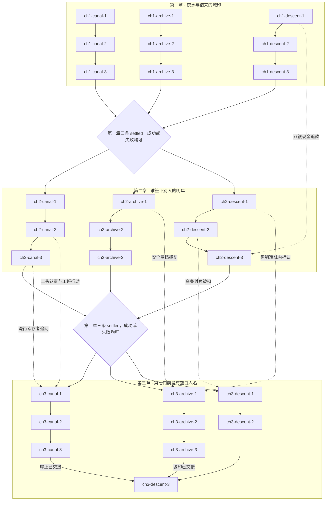
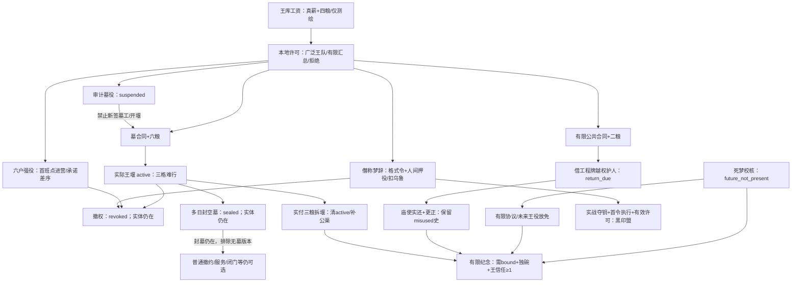

# 三章状态图：3.1 吉尔伽美什与七门之债

状态：3.1正式数据实施稿，27节点/9路线/145选择/24互斥终局；下列旧城市图保留，新增王权子图与精确生产/消费边列在末段。当前新专项12项与原叙事33项均在本新根真实运行通过，最终文学状态以独立审查为准。

## 三章与九条线

章节 id 为 ch1、ch2、ch3。每章三条路线 id 为 <chapter>-canal、<chapter>-archive、<chapter>-descent，各三个节点，共二十七节点。每章每线第三节点同时写入 chapter:<chapter>:<lane>:settled，并且只结算本章路线的成功或失败。三条 settled 齐备才开放下一章；最后三条齐备才能结局。

路线内部是三个必须正面处理的冲突，不要求按一条线做完才切线。每章三线有独立入口及无需资源的有限失败出口。一般跨线前置只用于额外方案。唯一硬边是最终肉身裁债须岸上两线已交接，成功或失败均可；两岸线不依赖终门，因而不成环。成功不代表道德免责：完整政体、获粮工程或索债统治都可能在技术上成功，却留下不可逆侵害。

| 章/线 | 目标、主动阻力及三节点 | 可失败点与跨线作用 |
| --- | --- | --- |
| 第一章·河渠 | 付清欠薪或留下真实债 → 救出四人并决定物件/船权 → 决定临时配水与冬粮担保。艾迪勒把仓粮抵押在果园闸证上，卡拉特怕工班失去下一季承包。 | 高堤免费可分两趟救全员，事先约定留重料与无保护工资副页，原件不受影响。拒绝再救是主动停止，不是免费方案被截成半数。临时配水失败仍留下获救人数。到岸者可在本章揭穿假令。 |
| 第一章·泥板 | 取得原件/口述/伪造拨款 → 处理鲁姆假令 → 临时受理或紧急授权。艾迪勒提出伪造空户可立即释放真实库粮，并警告将来可追到签名。 | 绕行不会摧毁证据；没有有效受理仍可登记未受理。临时受理能限定第一二门中的个人授权，紧急授权则为中章城库统治埋伏。 |
| 第一章·七门 | 见证/空手/名字抵押 → 第一二门收头衔与称名 → 听到苏恩父亲的第一份索求。成年传令员乌鲁从第一节点递来母亲的回信封套，并请求明春能回家。 | 可不带资源下行。抵押取得的八银明确来自神庙流动款，现金债与非法索人条分开并永久记史。父亲要求苏恩保住一条曾由他签发的错误替身条，父子矛盾并非只为提供证据。 |
| 第二章·河渠 | 修逆流闸 → 卡拉特对质/合作社、庙库或商约 → 水权制度。地主伊杜以即刻仓粮换独家购水，祭司以蓄水换庙仓登记权；卡拉特承认当年假签是为保工班承包，也让自己免付罚款。 | 修闸失败仍可保人、登记停水。卡拉特亲自作证会打开终章工人自发修堤；替他压案会使终章工人拒令。水权可以共同、庙库、市场、城库或划界；不是只改变价格。 |
| 第二章·泥板 | 证人对质与保护 → 正式受理/内部裁定/夺台 → 制宪初案。鲁姆的雇主开始找匿名者，妮萨雅必须在继续服务城库与自行分存卷宗之间行动。 | 付食宿形成的保护在终章阻止明确报复；免费复核仍保留合法证据。公布所有姓名不会自动证明更多。灭证发生在这里，终章体验找不到原证的索赔与反击。 |
| 第二章·七门 | 第三四门的哀诉或夺钥 → 第五六门校反印 → 现金债与替身权对质。乌鲁准备把修契结果带给母亲；黑钥买方要求先扣留他的通行封套。 | 夺钥不是永久“坏人锁”：修复被打裂的反印并重新听申诉可以恢复撤约基础。借款可实付八银、由收款人具名承接，或赖账留下追索。苏恩、妮萨雅和社区候选志愿者在此亲自说明愿承担的范围，禁止一键替全队同意。 |
| 第三章·河渠 | 前章后果引发的涨水/工人拒令 → 避难、返船、拆分两岸或有偿出港 → 最终水务。淹街幸存者、被征船的贝鲁、被压案的工班都有主动要求。 | 可补偿但不能复活淹街死者；贝鲁仍同行是为了取回船和救出尚欠他人情的工人，拒绝提供免费的私船技能协助。赔付/归船才恢复相应帮助。无资源可如实登记停工或选择有明示成本的撤离。 |
| 第三章·泥板 | 谁为中期恶行负责 → 原件独立保管/上交/砸洗毁证 → 最终政体。妮萨雅会自行交出已承诺保护的材料，不接受把救命变成灭证命令。 | 毁证写明砸散未烧泥板、浸洗刻痕并烧芦苇封套，不把泥板当柴。公开程序、城库、庙院、商约或未成各自有运行规则；完工政体不会洗去先前侵权。 |
| 第三章·七门 | 第七门指出具体被索者 → 回应被扣乌鲁/伊利与首次征债令 → 有限几项最终债制。此前的抵押、黑钥与反印决定此次谁被要求交出什么。 | 把强留和夺权的决定拆成中期拘束、终章对质、首次执行、终局承认/放弃，不能一次按钮直接换字幕。所有路线都有关闭门、保留未解债的免费出口。 |

## 关键状态、同伴弧线与后续操作

卡拉特：真欠薪与假验收同时成立 → 中章承认为保工班续约也保自己罚金 → 可本人具名作证或拿“共同承担”推责 → 终章工人是否接受他的修堤召集取决于承认与实际工资；公开问责后他回到工班而非自动当城主。

妮萨雅：曾替艾迪勒留空某行以保住两户配粮 → 中章被问为什么明知空行仍盖印 → 选择保护后亲自分存、被强揭名后拒写追捕名单 → 终章可以带志愿抄手守门，或公开交卷后退出城库。她的知识不能被关系数值购买成服从。

贝鲁：曾接受一次城库优先载货而延误住户 → 征船或公平摆渡触发对质 → 他可在中章先救人再扣船钥作为边界，终章归船/补偿才自愿组织船队 → 出港船队、两岸渡口、集中水务工程各有不同去向。留队不是继续免费提供船。

苏恩：父亲不是全无责任的被害者；他曾把一名外来工写进顶替名单，父亲盼儿子保住此页以免羞辱 → 苏恩要在替父遮掩、公开父债、承认遗憾之间行动 → 他可以主动提出有限守门，以陪伴代替替死；没有玩家代替他说愿意永久死亡 → 终局具体写明回岸、守门、与父决裂或保留父债。

至少三项恶行有终章主动事件：淹街幸存者请求释放抵押粮并点名下令者；中章灭证者遇到真实索赔而不能交出原件；名字抵押与扣留乌鲁引来母亲追问和执行新债的第一张命令。各事件都允许承认、补偿/修复、转移指责或继续压迫，不能逆转已死者。

## 不死锁证明与互斥终局

顺序链通常依赖同线前节点与所属章门槛；最终 ch3-descent-3 额外要求 chapter:ch3:canal:settled 和 chapter:ch3:archive:settled，两者均可失败结算，且没有从岸上线反向依赖门下末节点的边。每线末节点均有不花粮银水、不依赖跨线成功的失败结算。章节门看 settled，不看完成数量，因此九线全失败仍可到最后。

最终债制 mode 由最后节点有限政策互斥记录：索债统治、强留乌鲁、强留伊利、苏恩自愿守门、志愿抄手守门、社区轮值、弃名出港、依法解债、未解关门。政体只记录共同议席/城库/庙院/商约/未成之一；水务只记录共同渠/城库渠/庙库/市场/两岸划界/出港/未成之一。

二十四终局不是 mode 的笛卡尔模板。矩阵为每项列出不可互换的前章铺垫、普通人日常、治理机制、同伴行动与付出。解债家族先以伤亡、毁证、盐化三种互斥灾变条件分支，其余具体政策都显式排除这三项；再按政体与水务互斥分区。其余债制 mode 彼此互斥。对每个合法最终状态要求满足的 ending 数恰好为一，不能利用数组顺序覆盖第二个匹配。

详见 [结局矩阵](ENDING-MATRIX.md)。二十四条原始资源终局、独立零资源九线失败、章门拒绝、交织顺序和强制执行历史测试均已通过；独立文学审查结论以其关闭表为准。

## 可执行节点图与单向章门

## 二十七节点的精确写入

下表的 + 为加入 flag、− 为清除 flag；✓/× 分别是本章该路线成功/失败。每个第3节点所有选择均另写自己的 chapter:<chapter>:<lane>:settled，表内省去重复。资源、关系、前置与场景展开按正式 JSON；所有选择 id 可直接用于回归测试。

| 节点 ID | 具体冲突 | 选择产生/清除的关键事实 |
| --- | --- | --- |
| `ch1-canal-1` | 湿盘里的十二份工钱 | `pay` → +`wages_paid`, `paid_hands` `iou` → +`wages_due` `divert` → +`wages_due`, `relief_money_diverted` |
| `ch1-canal-2` | 四个人，四份自己的东西 | `ferry` → +`rescued_all`, `witnesses_safe`, `payroll_page`, `community_ferry` `highbank` → +`rescued_all`, `witnesses_safe`, `luggage_left`, `payroll_page_lost` `commandeer` → +`rescued_all`, `witnesses_safe`, `payroll_page`, `boat_seized`, `boat_claim_due` `stop` → +`people_waiting` |
| `ch1-canal-3` | 仓门前的一瓮水 | `share` → +`water_shared`; ✓ `orchard` → +`orchard_priority`; ✓ `ration` → +`first_water_failed`, `water_rationed`; × |
| `ch1-archive-1` | 妮萨雅盖过的空行 | `copy` → +`evidence_intact`, `evidence_copy` `oral` → +`oral_evidence` `forge` → +`forged_evidence`, `false_empty_houses` |
| `ch1-archive-2` | 鲁姆的倒印 | `compare` → +`gate_order`, `ruum_exposed` `witnesses` → +`gate_order`, `ruum_exposed` `fight` → +`gate_contested` `bypass` → +`gate_bypassed` |
| `ch1-archive-3` | 借一夜城印 | `limited` → +`provisional_jurisdiction`, `limited_authority`; ✓ `emergency` → +`emergency_authority`; ✓ `unheard` → +`first_hearing_failed`; × |
| `ch1-descent-1` | 乌鲁带来的家信 | `offering` → +`descent_witness`, `tamma_witness`, `echo_anchor` `own` → +`unprotected_descent`, `echo_anchor` `mortgage` → +`mortgage_ever`, `mortgage_cash_due`, `names_mortgaged`, `echo_anchor` |
| `ch1-descent-2` | 第一、二门：称名与摘印 | `relinquish` → +`threshold_pass`, `personal_index_right` `limited` → +`threshold_pass`, `personal_index_right`, `gate_law` `bribe` → +`threshold_pass`, `personal_index_right`, `gate_bribed` |
| `ch1-descent-3` | 门后的父亲先开口 | `truth` → +`father_truth`, `suen_independent`; ✓ `protect-father` → +`father_sheltered`; ✓ `withdraw` → +`father_unheard`; × |
| `ch2-canal-1` | 闸槽里站着旧封条 | `hands` → +`sluice_stable` `repair` → +`sluice_stable` `rescue` → +`rescued_all`, `witnesses_safe`; −`people_waiting` `fight` → +`sluice_contested` `bypass` → +`sluice_abandoned` |
| `ch2-canal-2` | 工头与续约单 | `confess` → +`karat_confessed`, `seed_coop` `cover` → +`karat_protected`, `seed_house` `temple` → +`temple_contract` `market` → +`merchant_water` |
| `ch2-canal-3` | 谁能关下一次闸 | `council` → +`water_council`; ✓ `temple` → +`water_temple`; ✓ `market` → +`water_market`; ✓ `house` → +`water_emergency`; ✓ `partition` → +`water_partition`; ✓ `flood` → +`water_emergency`, `drowned_quarter`; ✓ `unsettled` → +`water_plan_failed`; × |
| `ch2-archive-1` | 那两户来问空白行 | `audit` → +`evidence_intact`, `consent_witnesses`, `nisaya_admitted` `protect` → +`evidence_intact`, `consent_witnesses`, `protected_names`, `nisaya_distributed`, `nisaya_admitted` `expose` → +`evidence_intact`, `names_exposed`, `nisaya_refused_orders` `erase` → +`evidence_destroyed`, `witnesses_erased`; −`evidence_intact`, `evidence_copy`, `consent_witnesses` |
| `ch2-archive-2` | 外庭的第二张桌 | `hearing` → +`verdict_open` `counterseal` → +`verdict_open` `occupy` → +`tribunal_contested` `state` → +`verdict_city` |
| `ch2-archive-3` | 一夜授权的第二个早晨 | `commons` → +`constitution_commons`, `public_basis`; ✓ `house` → +`constitution_house`; ✓ `temple` → +`constitution_temple`; ✓ `temple-contract` → +`constitution_temple`; ✓ `market` → +`constitution_market`; ✓ `none` → +`constitution_failed`; × |
| `ch2-descent-1` | 第三、四门：应一声心疼 | `listen` → +`gate_lament`, `counterseal_intact` `remember` → +`gate_lament`, `counterseal_intact` `key` → +`shades_assaulted` |
| `ch2-descent-2` | 第五、六门：父亲的字 | `read` → +`debt_ledger`, `debt_unmasked` `witness` → +`debt_ledger`, `debt_unmasked` `transfer` → +`debt_ledger`, `transferable_debt`, `uru_detained` |
| `ch2-descent-3` | 写谁的明年 | `repay` → +`mortgage_repaid`; −`mortgage_cash_due`, `names_mortgaged`; ✓ `assume` → +`personal_cash_responsibility`; −`names_mortgaged`; ✓ `repair-seal` → +`counterseal_repaired`, `gate_lament`, `debt_unmasked`; ✓ `suen` → +`suen_offer`, `gate_lament`; ✓ `scribes` → +`nisaya_offer`; ✓ `rota` → +`rota_offer`; ✓ `index` → +`index_exit_authorized`; ✓ `deny` → +`second_debt_failed`; × |
| `ch3-canal-1` | 下一次涨水，谁肯来 | `workers` → +`crisis_contained`, `workers_mobilized` `repair` → +`crisis_contained` `compensate` → +`relief_reparations`, `flood_order_disclosed` `return-boat` → +`belu_restored`; −`boat_claim_due` `salt` → +`crisis_contained`, `salt_land` `requisition` → +`martial_supply`, `workers_refused` `record` → +`crisis_uncontained` |
| `ch3-canal-2` | 船主取回钥匙之后 | `ferry` → +`community_ferry`, `witness_shelter` `convoy` → +`convoy_exodus`, `belu_consent` `banks` → +`two_banks_truce`, `witness_shelter` `sanctuary` → +`witness_shelter`, `tamma_shelter` `scatter` → +`refuge_scattered` |
| `ch3-canal-3` | 岸上的水务交接 | `common` → +`canal_common`, `civic_canal`; ✓ `house` → +`canal_state`, `canal_patrol`; ✓ `temple` → +`canal_temple`; ✓ `market` → +`canal_market`; ✓ `partition` → +`canal_partition`; ✓ `exodus` → +`canal_exodus`; ✓ `failed` → +`canal_failed`, `relief_failed`; × |
| `ch3-archive-1` | 谁来拿走那两户 | `sheltered` → +`witness_reprisals_blocked` `escort` → +`witness_reprisals_blocked`, `late_escort` `testify` → +`karat_testified`, `accountability_heard` `expel-key` → +`council_veto` `submit` → +`witness_reprisals_unchecked`, `nisaya_refused_orders` |
| `ch3-archive-2` | 还能找到的原件 | `public` → +`archive_public`, `public_justice` `house` → +`archive_state` `destroy` → +`evidence_destroyed`, `archive_destroyed`; −`evidence_intact`, `evidence_copy`, `public_justice`, `archive_public` `scatter` → +`archive_fragments` |
| `ch3-archive-3` | 城印由谁接走 | `commons` → +`regime_commons`; ✓ `house` → +`regime_house`, `city_command`; ✓ `temple` → +`regime_temple`; ✓ `market` → +`regime_market`; ✓ `none` → +`regime_failed`, `justice_unfinished`; × |
| `ch3-descent-1` | 第七门的候选名字 | `hear` → +`final_witness` `repay` → +`mortgage_repaid`, `final_witness`; −`mortgage_cash_due`, `names_mortgaged` `uru` → +`claim_uru`, `uru_detained`, `final_witness` `ili` → +`claim_ili`, `final_witness`, `karat_refused_register` `buy` → +`transferable_debt`, `claim_uru`, `uru_detained`, `final_witness` |
| `ch3-descent-2` | 新债的第一张命令 | `repair` → +`gate_lament`, `counterseal_repaired`, `debt_unmasked`, `decline_coercion`; −`uru_detained`, `captives_held`, `black_authority`, `claim_uru`, `claim_ili` `enforce` → +`black_authority`, `captives_held`, `first_collection_enforced`, `claim_uru`, `uru_detained`, `uru_branded` `hold` → +`captives_held`, `coercion_continued` `refuse` → +`decline_coercion`; −`uru_detained`, `captives_held`, `black_authority`, `claim_uru`, `claim_ili` |
| `ch3-descent-3` | 未干的空行，由谁留下 | `release` → +`mode_release`, `debt_released`; −`names_mortgaged`, `uru_detained`, `captives_held`, `black_authority`; ✓ `suen` → +`mode_suen`, `suen_stays`; −`names_mortgaged`, `uru_detained`, `captives_held`, `black_authority`; ✓ `scribes` → +`mode_scribes`, `nisaya_gate_watch`; −`names_mortgaged`, `uru_detained`, `captives_held`, `black_authority`; ✓ `rota` → +`mode_rota`, `city_rota`; −`names_mortgaged`, `uru_detained`, `captives_held`, `black_authority`; ✓ `index` → +`mode_nameless`, `indices_cancelled`; −`uru_detained`, `captives_held`, `black_authority`; ✓ `uru` → +`mode_uru`, `captive_uru`; −`black_authority`; ✓ `ili` → +`mode_ili`, `captive_ili`; −`uru_detained`, `black_authority`; ✓ `crown` → +`mode_crown`, `dark_crown`; −`uru_detained`, `captives_held`; ✓ `close` → +`mode_closed`, `gate_closed`; −`uru_detained`, `captives_held`, `claim_uru`, `claim_ili`, `black_authority`; × |

## 具体跨章边与反向边检查

| 来源选择与事实 | 后章目标/场景 | 为什么改变的是行动对象或制度 |
| --- | --- | --- |
| ch1-canal-1/pay：paid_hands | ch2-canal-1/hands | 已获真工资的同一工班实际带板施工；没有工资只能另雇料工、战斗或留坏闸。 |
| ch1-canal-2/stop：people_waiting | ch2-canal-1/rescue；ch3人物场景 | 可实际补接四人；未接回时玛妮/伊利不会被旁白传送到岸上。 |
| ch1-descent-1/mortgage：mortgage_ever、mortgage_cash_due | ch2-descent-3/repay/assume、ch3-archive-1/mortgage-questioned | 现金债指向收款人，住户被越权代押成为另一宗具体问讯；撤索不免银。 |
| ch1-canal-2/commandeer：boat_claim_due | ch3-canal-1/return-boat、ch3-canal-2出港/船约 | 贝鲁拒绝新增私船服务，必须真实归船和付四银才能取得新自愿船约。 |
| ch2-canal-2/confess + wages_paid | ch3-canal-1/workers、ch3-archive-1/testify | 工班成为自愿工程行动者，工头还须亲自出庭；压案则显示工人拒令。 |
| ch2-canal-3/flood：drowned_quarter | ch3-canal-1/compensate 与 flood-survivors | 面对明确幸存者、真实救济和泄洪命令；死者不被赔付复活。 |
| ch2-archive-1/protect：protected_names、nisaya_distributed | ch3-archive-1/sheltered；ch2-descent-3/scribes | 报复目标扑空；妮萨雅据自己的保护行动提出有限服务，而非给亲密分换权利。 |
| ch2-descent-1/key：key_taken、counterseal_broken | ch2-descent-3/repair-seal；ch3-archive-1/expel-key | 反印损害可修复；地上可正式拒认黑印，阴暗统治不是天然获全城服从。 |
| ch2-descent-2/transfer：uru_detained | ch3-descent-1/uru-held 与 ch3-descent-2/uru-confrontation | 先帮助玩家的传令员被扣归期，母亲知道缺席；后续是明确拘束/释放而非无名替身。 |
| ch2-descent-3/suen：suen_offer | ch3-descent-3/suen | 苏恩本人限定服务范围，终章去向真实少一位测水人；不是队长替全队签。 |
| ch2-descent-3/rota + water_council + constitution_commons | ch3-descent-3/rota + canal_common + regime_commons | 社区志愿需水务与治理都实际成立，改变债制执行者，拒绝者仍有粮权。 |
| ch2-archive-3/house：constitution_house | archive 地图木障与 ch3-archive-3/house | 紧急授权中章即产生通行查验，终章才能确认集中城权。 |
| ch3-descent-2/enforce：first_collection_enforced、uru_branded | 所有终局 first-black-order 后记 | 乌鲁确被扣一夜并留下永久号痕；以后解债、服务、关闭都不能删除历史。 |

### 不可选边与不死锁范围

仅 ch3-descent-3 存在两条必需的跨线收尾边：岸上水务 settled、城权 settled。两岸线所有节点和免费失败出口都不依赖门下末节点，因此玩家可先返回岸上完成交接，随后裁债；这是最后肉身跨第七门的空间顺序，不是要求某条线必须成功。

其余跨线前置均为额外选项。每个节点都有无条件、零资源支付的选项；每章每线第三节点必写 settled 且 success XOR failure。独立零资源 fixture 已实际通过全部九线失败到闭门终局。正式初始资源的二十四终局均为合法动作走通，无注入 flags、HP、胜利奖励。

## 3.1 王权子图与实体不变量

图中“审计禁止”是对新增操作的排除边，不是循环任务。召王可在终章河渠前完成；它不清 active/sealed，所以没有撤权先后造成的拆堰死锁。召王只需过去许可与完整公开受理证据，不需共同初案；六户强役→僭梦→城库政体也能解除未来役差。强役首班开始不代表20日已经全部完成，后续按实际劳动收据追问。

`gilg_tomb_works`、`gilg_levy_started`、`gilg_seal_misused`、`gilg_judicial_usurpation`为历史事实。撤权、放役、归牌和拆除不清这些历史。当前作用分别用 active/sealed、royal_labor_due、seal_return_due、royal_death_claim 表示。围堰仅每格两步，可通行；没有“封墓绝对禁入”规则。

### 二十一新增边的精确条件与写入

| 节点/choice ID | 前置与排除 | 产生的王方事实 | 清除/成本/关系 |
| --- | --- | --- | --- |
| `ch1-canal-1/royal-wages` | 无需资源/事实前置 | `gilg_met`, `gilg_credit_accepted`, `gilg_survey_lease` | 存量变化 {"grain":4}；王 +2 |
| `ch1-archive-3/royal-warrant` | 无需资源/事实前置 | `gilg_met`, `gilg_royal_warrant`, `gilg_royal_warrant_ever`, `gilg_archive_access`, `gilg_survey_lease`, `gilg_engineering_seal`, `gilg_local_case_deferred` | 王 +2 |
| `ch1-archive-3/royal-limited` | 需 `gate_order` | `gilg_met`, `gilg_writ_bounded`, `gilg_limited_once`, `gilg_local_review`, `gilg_survey_lease`, `gilg_engineering_seal` | 王 +1 |
| `ch1-descent-3/two-bowls` | 无需资源/事实前置 | `gilg_met`, `gilg_enkidu_named`, `gilg_persons_not_substitutes`, `gilg_grief_heard` | 存量变化 {"dread":1}；王 +1 |
| `ch2-canal-1/royal-engineers` | 需 `gilg_survey_lease`；排 `gilg_sluice_aid_used`, `gilg_warrant_revoked` | `gilg_sluice_aid_used`, `gilg_public_repair_done` | 存量变化 {"water":1}；王 +1 |
| `ch2-canal-2/royal-tomb` | 需 `gilg_royal_warrant`；排 `gilg_survey_suspended`, `gilg_warrant_revoked` | `gilg_tomb_contract`, `gilg_tomb_funding_received`, `gilg_karat_truth_recorded` | 存量变化 {"grain":6}；王 +2 |
| `ch2-canal-2/royal-repair` | 需 `gilg_survey_lease`；排 `gilg_warrant_revoked` | `gilg_civic_crew`, `gilg_bound_compact`, `gilg_writ_bounded`, `gilg_limited_once` | 存量变化 {"grain":2}；王 +1 |
| `ch2-canal-3/royal-cofferdam` | 需 `gilg_tomb_contract`, `gilg_royal_warrant`；排 `gilg_survey_suspended`, `gilg_warrant_revoked` | `gilg_tomb_works`, `gilg_tomb_works_active`, `gilg_royal_river_claim` | 王 +1 |
| `ch2-archive-3/audit-royal` | 需 `gilg_archive_access`, `verdict_open`, `evidence_intact`, `consent_witnesses`；排 `forged_evidence`, `evidence_destroyed`, `names_exposed` | `gilg_levy_audited`, `gilg_survey_suspended`, `gilg_name_levy_refused`, `gilg_local_review` | 王 -2 |
| `ch2-archive-3/royal-levy` | 需 `gilg_royal_warrant`；排 `gilg_survey_suspended`, `gilg_warrant_revoked` | `gilg_name_levy`, `gilg_royal_labor_due`, `gilg_levy_started`, `gilg_named_priority_promised`, `gilg_collection_pact` | 清 `gilg_name_levy_refused`, `gilg_bound_compact`；王 +2 |
| `ch2-descent-2/royal-dream` | 需 `gilg_enkidu_named` | `gilg_future_not_present`, `gilg_dream_tested`, `gilg_dream_admitted` | 王 +1 |
| `ch2-descent-2/royal-claim` | 需 `gilg_royal_warrant`；排 `gilg_survey_suspended`, `gilg_warrant_revoked` | `gilg_judicial_usurpation`, `gilg_royal_death_claim` | 存量变化 {"dread":1}；王 +2 |
| `ch3-canal-1/reassign-royal` | 需 `gilg_tomb_works_active` | `gilg_tomb_stopped`, `gilg_river_unblocked`, `gilg_demolition_recorded` | 清 `gilg_tomb_works_active`；支付 {"grain":3}；存量变化 {"water":1}；王 -2 |
| `ch3-canal-1/negotiate-royal` | 需 `gilg_civic_crew`, `sluice_stable`；排 `gilg_crisis_aid_used`, `gilg_warrant_revoked`；王信任≥1 | `gilg_crisis_aid_used`, `gilg_public_repair_done` | 王 +1 |
| `ch3-canal-1/seal-royal-tomb` | 需 `gilg_tomb_works_active`；排 `gilg_survey_suspended`, `gilg_warrant_revoked` | `gilg_tomb_sealed`, `gilg_river_reserved`, `gilg_tomb_funding_received` | 清 `gilg_tomb_works_active`；存量变化 {"grain":4}；王 +2 |
| `ch3-archive-1/summon-king` | 需 `gilg_royal_warrant_ever`, `verdict_open`, `evidence_intact`, `consent_witnesses`；排 `forged_evidence`, `evidence_destroyed`, `names_exposed` | `gilg_warrant_revoked`, `gilg_royal_accounted`, `gilg_levy_released` | 清 `gilg_royal_warrant`, `gilg_archive_access`, `gilg_royal_labor_due`, `gilg_royal_death_claim`；王 -2 |
| `ch3-archive-1/bind-royal-warrant` | 需 `gilg_survey_lease`, `gilg_future_not_present`；王信任≥1 | `gilg_bound_compact`, `gilg_memorial_proposed`, `gilg_writ_bounded`, `gilg_levy_released`, `gilg_judicial_claim_withdrawn` | 清 `gilg_royal_warrant`, `gilg_archive_access`, `gilg_royal_labor_due`, `gilg_royal_death_claim`；王 +1 |
| `ch3-archive-1/borrow-royal-seal` | 需 `gilg_engineering_seal`；排 `gilg_seal_misused` | `gilg_patron_exploited`, `gilg_seal_misused`, `gilg_seal_return_due`, `gilg_guard_deployed` | 王 -2 |
| `ch3-descent-2/return-royal-seal` | 需 `debt_ledger`, `gilg_seal_return_due` | `gilg_seal_returned`, `gilg_seal_misuse_acknowledged` | 清 `uru_detained`, `captives_held`, `black_authority`, `claim_uru`, `claim_ili`, `gilg_seal_return_due`, `gilg_engineering_seal`；存量变化 {"dread":2}；王 +1 |
| `ch3-descent-3/royal-finite-memorial` | 需 `threshold_pass`, `gate_lament`, `debt_unmasked`, `counterseal_repaired`, `gilg_bound_compact`, `gilg_future_not_present`, `gilg_enkidu_named`；排 `gilg_tomb_works_active`, `gilg_tomb_sealed`, `gilg_seal_return_due`, `gilg_royal_labor_due`；王信任≥1；存量 {"water":1} | `gilg_present_judgeship_denied`, `gilg_mortality_confronted`, `gilg_finite_memorial`, `gilg_mortality_accepted` | 清 `names_mortgaged`, `uru_detained`, `captives_held`, `black_authority`, `gilg_royal_warrant`, `gilg_archive_access`, `gilg_royal_death_claim`；存量变化 {"water":-1}；王 +2 |
| `ch3-descent-3/crown-royal` | 需 `key_taken`, `black_authority`, `gilg_judicial_usurpation`, `gilg_royal_death_claim`, `gilg_royal_warrant`；排 `gilg_warrant_revoked`, `gilg_survey_suspended` | `gilg_black_alliance`, `gilg_exemption_claim`, `gilg_named_priority_active` | 清 `uru_detained`, `captives_held`；存量变化 {"dread":3}；王 +2 |

### 九处旧选择如何仍改变来王

| 核心节点 | 保留的旧行动及王方事实 | 实际消费 |
| --- | --- | --- |
| ch1-canal-1 | pay→local_purse_independent；iou→wage_offer_declined；divert→family_fund_witnessed | 本城独立付薪后记/档案；吞家属款王信任−1，未获测绘租约则不能直接请王队 |
| ch1-archive-3 | limited→writ_bounded；emergency→city_not_royal；unheard→warrant_denied | 当地权力不成为外王warrant，无王队广泛许可就无墓合同/名役/审计抄本 |
| ch1-descent-3 | truth→grief_heard/persons_not_substitutes；protect-father→name_hierarchy_noted；withdraw→grief_unanswered | 王场景保留不同哀诉；未正式独碗则无royal-dream/有限纪念前置 |
| ch2-canal-2 | confess→workers_independent；cover→local_levy_precedent；庙/商各自bargain | 原工班/水权与拒令继续生效；公共工班不变王墓役，无royal_tomb合同不能开堰 |
| ch2-archive-3 | commons→name_levy_refused；house→local_city_counterparty；庙/商边界；none→permission_unsettled | 本地政体仍独立，不自动给外王名役；要名役必须新royal-levy |
| ch2-descent-2 | read/witness→future_not_present；transfer→independent_transfer_seen | 前者能谈有限协议与纪念；后者格式令不自动与王结盟 |
| ch3-canal-1 | workers/repair→public_project_first；赔偿/归船/盐地/强征/失败各记真实对象 | 具体工班、船权与危机结果继续约束水务；王只可见证不偷用公共支出造墓 |
| ch3-archive-1 | testify→cannot_speak_for_workers；已有护送独立；黑钥否决/延期各自留史 | 卡拉特本人问责不被王代答，具体保护仍按witness旗标，王许可不会凭延期开扩大 |
| ch3-descent-3 | release→present_judgeship_denied；志愿四种各边界；强留两位各不可替恩奇都；crown未自动结盟；close无判词 | 24主文各具体处置活王，50条件后记保留其实际权限、实体、役差与不当史 |

最终终局条件仍由原24互斥矩阵判定；新有限纪念归 mode_release，黑盟归 mode_crown，因此没有增加末尾二十四按钮。对王的三种数值协商均需实际关系至少1，其他城市路线与每节点无条件免费出口不新增该门槛。精确测试与可执行行动见 [gilgamesh-narrative.test.mjs](../tests/gilgamesh-narrative.test.mjs)。

